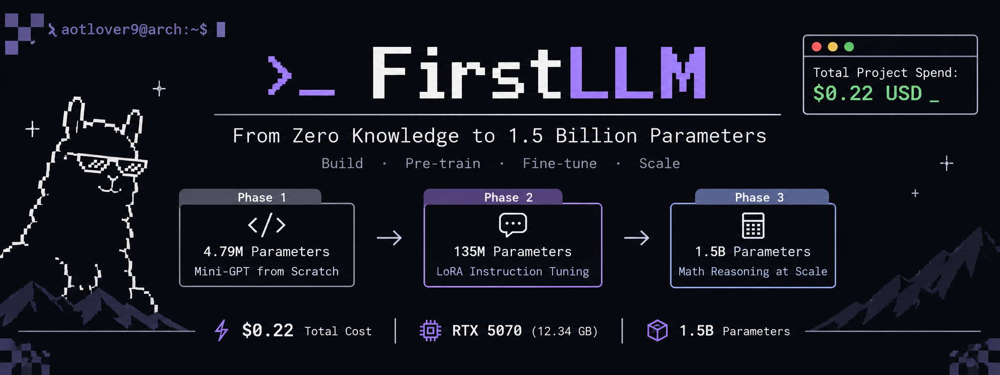

# FirstLLM

A hands-on repository demonstrating how to build, pre-train, fine-tune, and scale Generative Transformer Language Models from scratch up to 1.5B parameters on cloud hardware for a total spend of \$0.22 USD.

[](https://pytorch.org)
[](https://developer.nvidia.com/cuda-toolkit)
[](https://octa.space)
[](https://huggingface.co/Qwen/Qwen2.5-1.5B-Instruct)

---

## ⚡ Overview

* **Total Project Cost:** \$0.22 USD
* **Hardware:** NVIDIA GeForce RTX 5070 12GB
* **Compute Host:** OctaSpace
* **Progression:** 4.79M Scratch Transformer -> 135M LoRA -> 1.5B Math Reasoning Model

---

## 🧭 Project Phases

### Phase 1: Mini-GPT from Scratch
* Decoder-only Transformer with 4.79M parameters.
* Trained on Tiny Shakespeare corpus.
* Training finished in 2.79 minutes.
* Validation loss dropped from 4.21 to 1.56.
* Generates authentic Shakespearean dialogue structure.

### Phase 2: Instruction Fine-Tuning with LoRA
* Base model: SmolLM2-135M.
* Parameter-Efficient Fine-Tuning using LoRA adapters.
* Training finished in 45 seconds.
* Validation loss dropped from 2.23 to 0.25.
* Multi-turn terminal chat with creator identity awareness.

### Phase 3: 1.5B Math Scaling
* Base model: Qwen 2.5 1.5B Instruct.
* Trained on 3,000 real problems streamed from MetaMathQA.
* Gradient checkpointing enabled to maintain peak VRAM under 5.5 GB.
* Multi-step chain-of-thought derivations evaluated on JEE Advanced calculus.

---

## 🚀 Quickstart

### 1. Clone Repository
```bash
git clone https://github.com/aotlover9-base-eth/FirstLLM.git
cd FirstLLM
pip install -r requirements.txt
```

### 2. GPU Compatibility Setup
For RTX 30 and 40 series cards:
```bash
pip install torch torchvision --index-url https://download.pytorch.org/whl/cu124
```

For RTX 50 series cards:
```bash
pip install --upgrade --pre torch --index-url https://download.pytorch.org/whl/nightly/cu128
```

---

## 🏃 Running the Models

### Train Mini-GPT from Scratch
```bash
# Prepare dataset
python3 data.py

# Train model
python3 train.py --max_iters 3000 --batch_size 64 --device cuda

# Generate text
python3 generate.py --prompt "ROMEO:\n"
```

### Fine-Tune 1.5B Model on Math Dataset
```bash
python3 train_1b_math.py --max_samples 3000
```

### Interactive Chat
```bash
python3 chat.py --model Qwen/Qwen2.5-1.5B-Instruct
```
All chat logs are automatically appended to `chat_history.md`.

---

## 📂 Project Structure

```text
FirstLLM/
├── assets/
│   └── banner.png             # Project banner
├── checkpoints/
│   ├── best_model.pt          # Scratch Mini-GPT weights
│   ├── chat_lora/             # SmolLM2 135M LoRA adapter
│   └── qwen_math_lora/        # Qwen 1.5B Math LoRA adapter
├── data.py                    # Tokenizer & data preparation
├── model.py                   # PyTorch Transformer architecture
├── train.py                   # Scratch pre-training engine
├── generate.py                # Sampling and generation script
├── finetune_chat.py           # LoRA instruction fine-tuning
├── train_1b_math.py           # 1.5B scaling with MetaMathQA
├── chat.py                    # Interactive terminal chatbot
├── chat_history.md            # Recorded conversation logs
└── requirements.txt           # Python dependencies
```

---

## 📊 Results Summary

| Model | Parameters | Dataset | Train Time | Final Loss |
| :--- | :--- | :--- | :--- | :--- |
| **Mini-GPT** | 4.79M | Tiny Shakespeare | 2.79 min | 1.56 |
| **SmolLM2 LoRA** | 135M | Instruction Mix | 45 sec | 0.25 |
| **Qwen2.5 LoRA** | 1.5B | MetaMathQA | 11.2 min | 0.42 |

---

## Author
Created and trained by **Aotlover9**.
